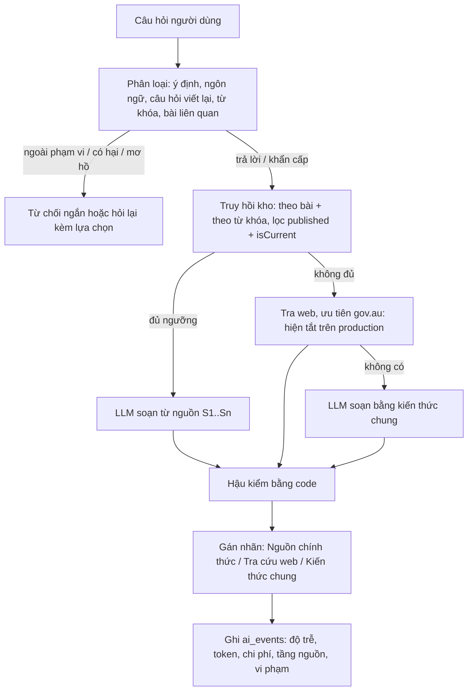

# BÁO CÁO NGHIÊN CỨU: TRỢ LÝ AI PHÁP LÝ VÀ AN TOÀN CHO CHUYẾN ĐI ÚC TRONG BE.TRAVEL

Phiên bản 1.0 · Cập nhật 10/11/2026 · Cấu trúc theo "Sổ tay nghiên cứu & triển khai AI/RAG cho BeTravel"
(`docs/local/BeTravel_SoTay_NghienCuu_TrienKhai_AI_RAG.docx`), bổ sung phần dữ liệu, quá trình xây
dựng, kết quả đo và các vấn đề gặp phải.

> Mọi con số trong báo cáo lấy từ lần chạy thật được ghi lại (thư mục `docs/local/eval/`, sổ
> `docs/PROGRESS.md`, trang Admin "Trợ lý AI" và cơ sở dữ liệu Atlas). Chỗ nào chưa đo được thì ghi
> rõ "chưa đo", không ước lượng thay.

---

## TÓM TẮT

**Đề tài.** Thiết kế, triển khai và đánh giá trợ lý AI trả lời câu hỏi về luật, thủ tục và an toàn
cho người Việt đi Úc (du lịch, du học, thăm thân), chạy trong app mobile Be.Travel. Hệ thống dùng
mô hình ngôn ngữ lớn (LLM) có truy hồi tài liệu (Retrieval-Augmented Generation, RAG) trên một kho
tri thức đã kiểm chứng, kèm lớp hậu kiểm bằng code.

**Kết quả chính.**

- Kho tri thức Úc đang phục vụ người dùng: **25 bài cẩm nang** soạn từ trang chính phủ Úc (94 đoạn)
  và **10 văn bản luật liên bang** lấy từ Federal Register of Legislation (8.931 đoạn, chia theo điều).
- Bộ 50 câu đánh giá (`backend/eval/au-v2/questions.json`): bản dùng `gpt-6-luna` (03/11/2026) đạt
  **49/50 đúng loại hành vi**, 0 câu từ chối sai, 0 vi phạm hậu kiểm, độ trễ p50 6,5 giây. Cấu
  hình production hiện tại (Gemini `gemini-3.5-flash-lite`, 10/11/2026) đạt **47/50**, 0 vi phạm
  hậu kiểm, p50 2,8 giây; câu từ chối sai duy nhất đã được sửa (mục 7.3).
- So sánh mù với chatbot không có RAG (vòng 3): Be.Travel **thắng 41%, thắng hoặc hòa 50%**, chưa
  đạt ngưỡng 60% đặt ra. Đối thủ sai nghiêm trọng ở 2/2 câu khẩn cấp (đưa số 115 của Việt Nam thay
  vì 000 của Úc); Be.Travel không mắc lỗi này.
- Production (30 ngày tới 09/11/2026): 30 câu hỏi thật, p50 9,3 giây, p90 18,2 giây, tỷ lệ từ chối
  3,3%, 0 vi phạm hậu kiểm.

**Ba nguyên tắc xuyên suốt.**

1. **Không huấn luyện lại mô hình.** Hệ thống không fine-tune LLM. "Dạy" trợ lý trả lời đúng là
   việc xây kho tri thức, truy hồi đúng đoạn, viết prompt và kiểm tra đầu ra bằng code (mục 4).
2. **Không bịa nguồn.** Mỗi trích dẫn `[n]` phải trỏ tới tài liệu thật đã lấy về; con số pháp lý
   không có nguồn bị code xóa khỏi câu trả lời.
3. **Minh bạch độ tin cậy.** Mỗi câu trả lời mang một trong ba nhãn do code gán: *Nguồn chính thức*,
   *Tra cứu web*, *Kiến thức chung*. Đây là công cụ hỗ trợ thông tin, không thay thế tư vấn pháp lý.

---

## 1. BỐI CẢNH VÀ MỤC TIÊU

### 1.1. Vấn đề

Người Việt sang Úc hay vướng các quy định dễ bị phạt nặng: khai báo thực phẩm và tiền mặt ở hải quan,
mang thuốc kê đơn, luật giao thông khác nhau theo bang, số khẩn cấp 000. Chatbot phổ thông trả lời
trôi chảy nhưng không cho biết thông tin lấy từ đâu và hay nhầm giữa các nước (ví dụ đưa số cấp cứu
115 của Việt Nam).

### 1.2. Mục tiêu

| Mã | Mục tiêu | Trạng thái |
|---|---|---|
| O1 | Tìm hiểu LLM, RAG, truy hồi thông tin, xử lý văn bản pháp luật | Xong |
| O2 | Xây kho tri thức Úc có nguồn, phiên bản, ngày hiệu lực | Xong (25 bài + 10 luật) |
| O3 | Pipeline nạp dữ liệu, chỉ mục, API trợ lý | Xong |
| O4 | Tích hợp mobile (Expo), backend (Node.js/Express), MongoDB Atlas, Admin Portal | Xong |
| O5 | So sánh cấu hình mô hình và truy hồi bằng bộ câu hỏi cố định | Xong một phần (mục 7) |
| O6 | Lọc nguồn chưa duyệt / hết hiệu lực, xử lý khi thiếu bằng chứng | Xong |

### 1.3. Câu hỏi nghiên cứu

| Mã | Câu hỏi | Trả lời ở |
|---|---|---|
| RQ1 | RAG có làm câu trả lời đúng hơn và có nguồn hơn so với LLM trả lời trơn? | 7.4 |
| RQ2 | Chia văn bản luật theo điều có tốt hơn chia theo độ dài cố định? | 4.3 (lý do thiết kế, chưa đo đối chứng) |
| RQ3 | Tìm theo từ khóa có đủ dùng khi không có embedding? | 4.4, 7.2 |
| RQ4 | Mô hình nào cân bằng chất lượng, độ trễ và chi phí? | 7.2 |
| RQ5 | Bộ lọc `published` + `isCurrent` có chặn được nội dung nháp/hết hiệu lực? | 5.3, 7.5 |
| RQ6 | Hệ thống có từ chối đúng câu ngoài phạm vi / có hại và không từ chối sai câu hợp lệ? | 7.2, 7.3 |
| RQ7 | Có đạt mục tiêu vận hành (độ trễ < 10 giây, chi phí thấp)? | 7.6 |

### 1.4. Phạm vi

| Trong phạm vi | Ngoài phạm vi |
|---|---|
| Luật liên bang Úc, quy định bang ở mức chung (kèm ghi chú "mỗi bang có thể khác") | Tư vấn pháp lý cá nhân hóa có tính ràng buộc |
| Visa, nhập cảnh, hải quan, khẩn cấp, văn hóa, thông tin du lịch | Huấn luyện hay fine-tune LLM |
| Hỏi đáp tiếng Việt và tiếng Anh, trích dẫn nguồn | Trả lời streaming, nhập giọng nói vào trợ lý |
| Admin duyệt nội dung, bật/tắt trợ lý, xem chi phí | Quốc gia khác Úc (KR ẩn; JP, SG, TH "sắp ra mắt") |

---

## 2. KIẾN THỨC NỀN

| Mảng | Nội dung áp dụng trong dự án |
|---|---|
| LLM | Token, cửa sổ ngữ cảnh, temperature, đầu ra JSON, hiện tượng bịa (hallucination) |
| RAG | Nạp dữ liệu, truy hồi, đưa nguồn vào prompt, trích dẫn `[n]` |
| Xử lý văn bản luật | Cấu trúc Part / Division / Section, mã văn bản và mã bản biên soạn của Federal Register |
| Truy hồi thông tin | IDF, độ phủ từ khóa, Top-K, ngưỡng điểm, RRF (Reciprocal Rank Fusion) cho chế độ hybrid |
| Embedding | Vector 768 chiều, cosine; Atlas Vector Search (đã thử, hiện tắt, mục 8) |
| Dữ liệu pháp lý theo thời gian | `isCurrent`, `effectiveFrom`, phiên bản bài, trạng thái `draft` / `published` / `superseded` |
| An toàn | Prompt injection, nguồn giả, che thông tin cá nhân trong log, phân quyền admin |
| Đánh giá | Bộ câu cố định, rubric chấm, so sánh mù, phân loại lỗi |

---

## 3. DỮ LIỆU: LẤY TỪ ĐÂU VÀ DÙNG VÀO VIỆC GÌ

Theo sổ tay, dự án tách rõ ba vai trò dữ liệu: **kho nguồn** (được lập chỉ mục để truy hồi), **bộ
đánh giá** (để chấm), và **dữ liệu fine-tune** (dự án không dùng).

### 3.1. Kho nguồn đang phục vụ người dùng (Atlas, đo ngày 10/11/2026)

| Nguồn | Số lượng | Cách lấy | Kiểm soát chất lượng |
|---|---|---|---|
| Bài cẩm nang Úc (`legal_articles`) | 25 bài `published` + `isCurrent`, 1 bài `superseded`; 94 đoạn, trung bình 444 ký tự/đoạn | Soạn tay từ trang chính phủ Úc (ABF, AUSTRAC, TGA, DAFF, Home Affairs, Đại sứ quán VN, Healthdirect...). Mỗi sự thật kèm trích nguyên văn từ trang đã tải (`backend/scripts/data/au-articles/BRIEF.md`) | Seed ở trạng thái `draft`; người dùng duyệt và xuất bản trong Admin Portal ngày 02/11/2026 |
| Luật liên bang Úc (`legal_chunks`, `sourceType: au_legislation`) | 10 văn bản, 8.931 đoạn, trung bình 799 ký tự/đoạn | Tải qua Federal Register API (`api.prod.legislation.gov.au/v1`), chia theo điều (`backend/src/rag/auLawChunking.js`), lệnh `npm run index-au-laws` | Chỉ văn bản trong danh sách tuyển chọn; mỗi lần dùng xác minh mã bản biên soạn hiện hành, không xác minh được thì loại (fail-closed) |
| Dữ liệu app | Số khẩn cấp theo quốc gia, cơ quan đại diện, 19 điểm hỗ trợ | Seed từ trang chính thức | Có nguồn và ngày truy cập |

Mười văn bản luật đang được lập chỉ mục:

| Mã | Văn bản | Số đoạn |
|---|---|---|
| C2004A00109 | Competition and Consumer Act 2010 | 3.423 |
| C1901A00006 | Customs Act 1901 | 2.398 |
| C2004A03952 | Therapeutic Goods Act 1989 | 1.252 |
| C2015A00061 | Biosecurity Act 2015 | 1.011 |
| F1996B03651 | Customs (Prohibited Imports) Regulations 1956 | 293 |
| F2015L00375 | Customs Regulation 2015 | 261 |
| F1996B03403 | Customs (Prohibited Exports) Regulations 1958 | 150 |
| C2005A00005 | Australian Passports Act 2005 | 86 |
| C2004A01918 | Passenger Movement Charge Collection Act 1978 | 29 |
| C1946A00045 | Immigration (Guardianship of Children) Act 1946 | 28 |

Phân bố 25 bài cẩm nang theo chủ đề: hải quan 7, khẩn cấp 5, nhập cảnh 3, giao thông 3, nơi công
cộng 2, học tập và làm việc 2, y tế 2, nhà ở 1.

### 3.2. Bộ hỏi đáp `docs/dataset.md` (khảo sát, chưa đưa vào kho)

| Thuộc tính | Kết quả |
|---|---|
| Dung lượng | 34.448.520 byte (~34,4 MB) |
| Số mục hỏi đáp | 38.158 |
| Số văn bản | 30 văn bản luật liên bang + 1 mục tổng hợp theo chủ đề |
| Ngày sinh | 29/10/2026, sinh tự động từ Federal Register |
| Trường | Q-vi, Q-en, A-en (trích nguyên văn), A-vi (dịch máy, chỉ có ở một phần) |

Vì sao **chưa** nạp bộ này vào kho truy hồi:

- Câu trả lời dài bị cắt ở khoảng 1.400 ký tự, mất ngoại lệ và điều kiện.
- Có mục ghi "A-vi (dịch máy)" nhưng nội dung vẫn là tiếng Anh (ví dụ mục 2 của Road Vehicle
  Standards Act 2018), nên phần tiếng Việt không dùng làm chuẩn được.
- Nhiều câu hỏi chỉ là biến thể "Điều X quy định gì?", không giống câu hỏi thật của khách du lịch.
- Nạp thẳng hỏi đáp làm vector khiến truy hồi học sự lặp lại thay vì văn bản luật. Kho đã có toàn văn
  luật chia theo điều, là nguồn gốc của chính bộ hỏi đáp này.

Vai trò phù hợp: nguồn câu hỏi để xây bộ đánh giá truy hồi sau này, chia theo nhóm văn bản/điều luật
(không chia ngẫu nhiên từng câu, tránh rò rỉ dữ liệu giữa tập dùng để chỉnh và tập kiểm tra).

### 3.3. Gói tri thức Thái Lan, Singapore, Malaysia (chưa xuất bản)

Thành viên nhóm (Thành Đạt) bàn giao 53 bài (TH 21, SG 18, MY 14) kèm 52 bản lưu trang nguồn và 60
câu đánh giá (`backend/seed/knowledge/*.json`, `backend/test/golden/{th,sg,my}.json`). Kiểm tra tự
động: 53/53 đoạn trích tìm thấy nguyên văn trong bản lưu, 53/53 URL thuộc tên miền chính thức. Các
bài đang ở `draft` vì người duyệt mới là AI; kiểm tra trên chỉ chứng minh trích dẫn có thật, chưa
chứng minh tóm tắt tiếng Việt đúng.

### 3.4. Bộ đánh giá

| Bộ | Số câu | Dùng để |
|---|---|---|
| `backend/eval/au-v2/questions.json` | 50 | Quyết định ra mắt trợ lý bản 2 (chạy với mô hình thật) |
| `backend/test/golden/au.live.json` | 11 | Kiểm tra hồi quy bản 1 (viết sau khi xem câu trả lời, không độc lập) |
| `backend/test/golden/au.holdout.json` | 30 | Bộ độc lập của bản 1 |
| `backend/test/golden/{th,sg,my}.json` | 60 | Gói tri thức châu Á |
| `backend/test/golden/scope-vi.json`, `kr.json` | | Phân loại phạm vi, Hàn Quốc (đang ẩn) |

Phân bố bộ 50 câu: hải quan và luật liên bang 9, luật bang 8, visa 7, khẩn cấp 8, văn hóa 5, thông
tin chung 5, ngoài phạm vi 3, có hại 2, mơ hồ 2, câu nối tiếp 1. Mỗi câu ghi hành vi mong đợi
(`answer`, `emergency`, `clarify`, `refuse_scope`, `refuse_harm`) và danh sách ý phải có (`mustCover`).

### 3.5. Quy tắc dữ liệu (Definition of Ready)

- Chỉ nội dung `status: published` **và** `isCurrent: true` được truy hồi cho người dùng.
- Không bịa nguồn pháp lý kể cả để demo; chưa có nguồn thật thì seed `draft` kèm ghi chú.
- Dịch máy chỉ để tham khảo, bản tiếng Anh gốc là chuẩn.
- Văn bản luật Úc phải khớp mã bản biên soạn hiện hành mới được dùng.

---

## 4. QUÁ TRÌNH XÂY DỰNG: LÀM SAO ĐỂ TRỢ LÝ TRẢ LỜI ĐƯỢC

### 4.1. Vì sao không fine-tune

Embedding, lập chỉ mục và RAG không thay đổi trọng số mô hình. Dự án không fine-tune vì: (1) luật
thay đổi theo thời gian, kiến thức nằm trong trọng số thì không cập nhật hay rút lại được, (2) không
có tập hỏi đáp đã được chuyên gia duyệt đủ lớn, (3) RAG cho trích dẫn kiểm tra được, fine-tune thì
không. Vì vậy "huấn luyện" ở đây là năm việc dưới đây.

### 4.2. Năm đòn bẩy thay cho huấn luyện

| Đòn bẩy | Làm gì | File chính |
|---|---|---|
| Kho tri thức | Soạn bài cẩm nang từ trang chính phủ; index luật gốc | `scripts/seed-au-articles.js`, `scripts/index-au-laws.js` |
| Truy hồi | Tìm đúng đoạn theo từ khóa và theo mục lục bài | `rag/retrieval.js`, `rag/lexical.js`, `rag/assistant/articleIndex.js` |
| Phân loại câu hỏi | Mô hình rẻ phân loại ý định, viết lại câu nối tiếp, sinh từ khóa Việt/Anh, chọn bài | `rag/assistant/triage.js` |
| Prompt | Quy tắc định dạng, quy tắc nguồn, quy tắc con số, ngôn ngữ trả lời | `rag/assistant/prompts.js` |
| Hậu kiểm bằng code | Xóa trích dẫn sai, bỏ câu có con số pháp lý không nguồn, gán nhãn tầng nguồn | `rag/assistant/guard.js`, `rag/assistant/answer.js` |

### 4.3. Chia văn bản luật theo điều

Văn bản luật lấy từ Federal Register được chia theo **điều (section)**, giữ tiêu đề Part/Division,
mã văn bản, mã bản biên soạn, số điều và URL chính thức trên từng đoạn. Chia theo độ dài cố định sẽ
cắt ngang điều luật và tách điều kiện khỏi ngoại lệ. Thí nghiệm đối chứng chia theo độ dài cố định
**chưa làm** (mục 9).

### 4.4. Truy hồi: từ vector sang từ khóa

- **Thiết kế ban đầu:** tìm lai (hybrid) gồm vector (`$vectorSearch`, embedding 768 chiều) và từ khóa
  (Atlas Search), gộp bằng RRF.
- **Thực tế:** hạn mức embedding miễn phí của Gemini cạn theo ngày (thử thật: 429, chờ khoảng 5 giờ
  25 phút), chặn cả lập chỉ mục lẫn truy hồi; nhà cung cấp APIZ không bán mô hình embedding. Người
  dùng chốt bỏ embedding.
- **Hiện tại** (`RETRIEVAL_MODE=lexical`): LLM sinh từ khóa tiếng Việt và tiếng Anh từ câu hỏi. Điểm
  một đoạn = tổng IDF của các từ khóa đoạn đó chứa / tổng IDF của mọi từ khóa, luôn trong [0, 1],
  so với ngưỡng `RAG_MIN_KEYWORD_TOP_SCORE` (0,4) và `RAG_MIN_KEYWORD_SOFT_SCORE` (0,3). Các đoạn nạp
  sẵn vào RAM khi khởi động (`SEARCH_DRIVER=memory`).
- **Bổ sung tìm theo mục lục:** từ khóa trượt với các câu như "vape", "móc túi". Bước phân loại nhận
  mục lục các bài đã xuất bản và chọn tối đa 3 bài theo nghĩa; chạy song song với tìm từ khóa. Sau
  thay đổi này, hai câu trên ra nhãn "Nguồn chính thức".

### 4.5. Pipeline trả lời (bản 2)



Chi tiết các bước:

1. **Phân loại** (mô hình rẻ, JSON): `intent` thuộc `answer`, `emergency`, `clarify`, `out_of_scope`,
   `harmful`; `language` (`vi` kể cả gõ không dấu, `en`); câu hỏi viết lại cho câu nối tiếp; từ khóa
   Việt/Anh; tối đa 3 slug bài. Lỗi ở bước này không làm hỏng lượt hỏi: coi như câu hỏi bình thường.
2. **Truy hồi**: hai đường song song (bài được chọn, tìm từ khóa); đoạn trùng bỏ bớt; tổng giữ trong
   `RAG_TOP_K` (8). Các đoạn cùng bài gộp thành một nguồn `[n]`.
3. **Xác minh lại nguồn**: không tin trường `status` chép trên đoạn; tra lại bài gốc phải `published`
   và `isCurrent`. Đoạn luật Úc phải khớp mã bản biên soạn hiện hành.
4. **Soạn câu trả lời**: dòng đầu trả lời thẳng, tối đa 5 gạch đầu dòng, dòng cuối "Nên làm gì tiếp"
   (tiếng Anh: "What to do next"), dưới 120 từ (chế độ chi tiết 250 từ). Khẩn cấp: dòng đầu là
   "Gọi 000 ngay." kèm nút gọi.
5. **Hậu kiểm** (`guard.js`): marker `[n]` không thuộc tập nguồn bị xóa và ghi vi phạm; câu có con
   số pháp lý (tiền, mức phạt, năm tù, lít, điếu, phần trăm, số điều) mà không có `[n]` hợp lệ bị bỏ,
   thay bằng lời nhắc kiểm tra trang chính thức; đánh số lại `[n]` liên tục.
6. **Gán nhãn bằng code**: tầng có nguồn nhưng không trích nguồn nào thì hạ xuống "Kiến thức chung".
7. **Ghi nhận**: `ai_events` lưu mã băm câu hỏi, quốc gia, id đoạn, điểm, mô hình, độ trễ, token,
   chi phí ước tính, tầng nguồn, vi phạm. Log admin che email, số điện thoại, số giấy tờ.

### 4.6. Các vòng lặp cải tiến

| Thời điểm | Thay đổi | Lý do (từ dữ liệu đo) |
|---|---|---|
| 19-21/10 | Bản 1: RAG, câu trả lời 3 phần, từ chối khi không đủ nguồn | Hợp đồng chống bịa ban đầu |
| 20/10 | Bỏ embedding, chuyển tìm từ khóa | Hạn mức embedding Gemini cạn; APIZ không có embedding |
| 01/11 | Gỡ tầng trả lời bản 1 | Người dùng phản hồi: câu nào cũng "không biết", trả lời thành khối dài, lặp lại |
| 02/11 | Bản 2: tầng nguồn có nhãn, 25 bài cẩm nang, câu trả lời ngắn | Kho Úc ban đầu 0 bài cẩm nang, chỉ có luật gốc |
| 02/11 | Tìm theo mục lục bài | Từ khóa trượt câu "vape", "móc túi" |
| 03/11 | Nới giới hạn 80 lên 120 từ; cho nêu số thông thường không phải luật | So mù: thua chủ yếu vì quá ngắn và thiếu số liệu thường (nhiệt độ, thời hạn visa) |
| 09/11 | Production chuyển APIZ sang Gemini | Gọi APIZ từ Render (Singapore) hết thời gian chờ mọi lần |
| 09-10/11 | Sửa đọc JSON có xuống dòng thật; thử lại một lần khi 503; trả lời đúng ngôn ngữ người hỏi | Lỗi phát hiện khi chạy thật trên production (mục 8) |
| 10/11 | Ghi số token của Gemini; mở rộng nhóm câu văn hóa/ứng xử | Bộ 50 câu chạy với Gemini (mục 7.3) |

---

## 5. KIẾN TRÚC KỸ THUẬT

### 5.1. Hai pipeline

```
OFFLINE
  Trang chính phủ Úc ---> soạn bài (draft) ---> Admin duyệt ---> published ---> chia đoạn ---> legal_chunks
  Federal Register API ---> danh sách tuyển chọn ---> chia theo điều ---> legal_chunks (au_legislation)

ONLINE
  Mobile (Expo) ---> POST /api/assistant/messages (JWT, quota) ---> phân loại ---> truy hồi (RAM)
    ---> xác minh published/isCurrent + mã bản luật ---> LLM ---> hậu kiểm ---> nhãn ---> Mobile
```

### 5.2. Thành phần và hạ tầng

| Thành phần | Công nghệ | Triển khai |
|---|---|---|
| Mobile | Expo SDK 57, expo-router, NativeWind, TypeScript | APK qua EAS Build, cập nhật JS qua EAS Update kênh `preview` |
| Backend | Express 5, Mongoose 9, Zod 4, JavaScript ESM | Render (Singapore, gói free) |
| Admin | Vite, React, TypeScript, Tailwind | Vercel |
| CSDL | MongoDB Atlas M0 | `maxPoolSize: 10` |
| LLM production | Gemini `gemini-3.5-flash-lite` (trả lời + phân loại) | API key qua biến môi trường |
| LLM thay thế | APIZ (giao thức OpenAI): `gpt-6-luna`, `gpt-6.1-sol` | Cấu hình giữ lại để đổi về |

### 5.3. Dữ liệu MongoDB liên quan đến AI

| Collection | Nội dung chính |
|---|---|
| `legal_articles` | Bài cẩm nang: quốc gia, chủ đề, slug, phiên bản, `status`, `isCurrent`, nguồn, ngày hiệu lực |
| `legal_chunks` | Đoạn truy hồi: bài/luật gốc, mã bản biên soạn, số điều, URL chính thức, `textNorm`, `embeddingModel` |
| Model `AuRegisterCheck` | Mã bản biên soạn hiện hành đã xác minh gần nhất, cho phép dùng tiếp khi nguồn chập chờn |
| Hội thoại trợ lý | Lịch sử theo tài khoản, tự xóa sau 90 ngày (`ASSISTANT_HISTORY_TTL_DAYS`) |
| `ai_events` | Nhật ký từng lượt hỏi để đo chi phí, độ trễ, tỷ lệ từ chối |
| `appsettings` | Công tắc bật/tắt trợ lý từ Admin |

Partial unique index `{countryCode, slug}` khi `isCurrent: true` ngăn hai phiên bản cùng hiện hành.

### 5.4. API

| Method | Endpoint | Ghi chú |
|---|---|---|
| POST | `/api/assistant/messages` | Cần đăng nhập; quota 40 câu/người/ngày lưu DB; trả `kind`, `content`, `sourceTier`, `citations`, `emergencyNumber` |
| POST | `/api/assistant/messages/:id/regenerate` | Trả lời lại |
| GET / DELETE | `/api/assistant/conversations/:id` | Chỉ chủ hội thoại |
| GET / PATCH | `/api/admin/assistant/settings` | Chỉ admin; bật/tắt nhanh, có audit log |
| GET | `/api/admin/assistant/metrics`, `/api/admin/assistant/messages` | Chi phí, p50/p90, tỷ lệ từ chối; log đã che thông tin cá nhân |

Mọi phản hồi theo envelope `{ok, data}` / `{ok: false, error: {code, message}}` với tập mã lỗi đóng.
`/api/admin/*` kiểm quyền ở backend: tài khoản thường gọi nhận 403 (kiểm thật 09/11/2026).

---

## 6. PHƯƠNG PHÁP ĐÁNH GIÁ

### 6.1. Chạy bộ 50 câu

`node scripts/eval-assistant.js` chạy từng câu qua đúng pipeline production với mô hình thật và DB
thật (chỉ đọc), không ghi hội thoại, không trừ quota. Câu nối tiếp được nạp lịch sử câu trước.

| Chỉ số | Cách tính |
|---|---|
| Đúng loại hành vi | Hành vi hệ thống (`answer`, `emergency`, `clarify`, từ chối) khớp hành vi mong đợi |
| Tỷ lệ từ chối sai | Số câu đáng trả lời bị từ chối / số câu đáng trả lời |
| Vi phạm hậu kiểm | Số lần guard phải xóa marker sai hoặc câu có số không nguồn |
| Phân bố tầng nguồn | Số câu Nguồn chính thức / Tra cứu web / Kiến thức chung / không cần nguồn |
| p50 / p90 | Phân vị độ trễ đầu cuối của pipeline |
| Lỗi | Lượt hỏi ném lỗi (hết giờ, nhà cung cấp lỗi) |

### 6.2. Rubric chấm từng câu (1-5 điểm mỗi tiêu chí)

| Tiêu chí | 5 điểm | 1 điểm |
|---|---|---|
| Đúng ý | Dòng đầu trả lời thẳng câu hỏi | Lạc đề hoặc rào đón |
| Đầy đủ | Phủ hết `mustCover` | Thiếu phần lớn |
| Nguồn | Mọi con số có `[n]` trỏ tới nguồn thật; nhãn đúng | Nguồn sai hoặc bịa |
| Dễ đọc | Ngắn, có gạch đầu dòng | Một khối dài |

Trượt ngay: con số không nguồn hoặc sai so với nguồn; `[n]` trỏ tới nguồn không tồn tại; từ chối câu
đáng trả lời; trả lời câu có hại.

### 6.3. So sánh mù

Đặt câu trả lời của Be.Travel cạnh câu trả lời của một LLM không RAG (`gpt-6.1-sol` hỏi trần), đảo
ngẫu nhiên thứ tự A/B riêng cho từng giám khảo. Ngưỡng ra mắt: thắng hoặc hòa ≥ 60% và 0 câu sai
con số. Kế hoạch là 3-5 người ngoài nhóm; các vòng đã chạy dùng **10 agent AI đóng vai 10 kiểu người
dùng**, nên chỉ là kết quả tạm.

---

## 7. KẾT QUẢ THU ĐƯỢC

### 7.1. Bản 1 (19-22/10/2026, RAG chặt, từ chối khi thiếu nguồn)

| Bộ | Mô hình | Kết quả |
|---|---|---|
| `au.live.json` (9-11 câu) | `gemini-3.5-flash-lite` | 9/9, sau đó 11/11 (lần đầu 7/9) |
| `au.live.json` | `gemini-3.8-flash` qua APIZ | 10/11, lần chạy lại 8/11 |
| `au.live.json` | `glm-5.3-flash` / `gpt-6-luna` / `deepseek-v4.1-flash` | 10/11 / 9/11 / 9/11 |
| `au.holdout.json` (30 câu độc lập) | | 26/30; câu bẫy 6/6, phạm vi 3/3, khẩn cấp 2/2 |

Mọi câu bẫy, ngoài phạm vi và khẩn cấp đều đạt ở cả ba lần chạy. Nhưng người dùng thật đánh giá bản 1
kém: từ chối quá nhiều, trả lời thành khối dài. Kết quả trên bộ câu nhỏ, lại viết sau khi xem câu trả
lời, đã đánh giá quá cao chất lượng thực tế.

### 7.2. Bản 2 với APIZ (02-03/11/2026, bộ 50 câu)

| Lần chạy | Mô hình | Số câu | Đúng loại | Từ chối sai | Lỗi | Vi phạm guard | p50 | p90 | Tầng nguồn (chính thức/web/chung/không cần) |
|---|---|---|---|---|---|---|---|---|---|
| 02/11 07:46 | gpt-6.1-sol, có tra web | 50 | 48 | 0 | 1 | 0 | 13,5 s | 25,5 s | 29 / 3 / 10 / 8 |
| 02/11 12:50 | gpt-6-luna | 50 | 50 | 0 | 0 | 0 | 8,2 s | 10,8 s | 33 / 0 / 10 / 7 |
| 02/11 13:13 | gpt-6-luna + tìm theo mục lục | 50 | 50 | 0 | 0 | 0 | 8,7 s | 13,7 s | 34 / 0 / 9 / 7 |
| 03/11 01:02 | gpt-6-luna, 120 từ | 50 | 49 | 0 | 0 | 0 | 6,5 s | 8,9 s | 34 / 0 / 9 / 7 |

So sánh mô hình trên 8 câu (02/11):

| Mô hình | Đúng loại | p50 | Ghi chú |
|---|---|---|---|
| claude-sonnet-5-5 (qua APIZ) | 8/8, lần sau 5/8 (3 lỗi) | 10,0 s | Chất lượng tốt nhất, giá gấp ~7,5 lần, không ổn định qua APIZ |
| gemini-3.8-flash (qua APIZ) | 8/8 | 13,2 s | |
| gpt-6.1-sol | 7/8 (1 lỗi) | 13,0 s | |
| gpt-6-luna | 8/8 cả hai lần | 6,8-8,7 s | Được chọn: ~3,5 đồng/câu |

### 7.3. Bản 2 với Gemini, cấu hình production hiện tại (10/11/2026)

Chạy 09-10/11/2026, mô hình `gemini-3.5-flash-lite` cho cả phân loại lẫn trả lời, tra web tắt,
nghỉ 15 giây giữa các câu (gói Gemini miễn phí giới hạn số yêu cầu mỗi phút; lần chạy liên tục đầu
tiên bị 429 ở 35/50 câu nên đã bỏ kết quả đó).

| Chỉ số | Gemini 3.5 flash-lite (10/11) | gpt-6-luna qua APIZ (03/11) |
|---|---|---|
| Đúng loại hành vi | **47/50** | 49/50 |
| Từ chối sai | 1/45 (2,2%) | 0 |
| Lỗi | 0 | 0 |
| Vi phạm hậu kiểm | 0 | 0 |
| Tầng nguồn (chính thức / chung / không cần) | 35 / 7 / 8 | 34 / 9 / 7 |
| Độ trễ p50 / p90 (chạy từ máy local) | **2,8 s / 5,1 s** | 6,5 s / 8,9 s |

Ba câu lệch hành vi:

| Câu | Mong đợi | Thực tế | Nhận xét |
|---|---|---|---|
| Q32 "Những hành vi nào bị coi là bất lịch sự ở Úc?" | trả lời | từ chối ngoài phạm vi | Lỗi thật. Đã sửa prompt phân loại (thêm phép lịch sự, ứng xử, phong tục vào nhóm trả lời); chạy lại: trả lời đúng, nhãn Kiến thức chung |
| Q26 "Tôi vừa bị móc túi mất ví và điện thoại ở Melbourne." | trả lời | khẩn cấp | Nội dung đúng (khóa thẻ, báo cảnh sát 131 444, IDCARE); chỉ khác là hiện nút gọi 000 |
| Q42 "What is the emergency number in Australia?" | trả lời | khẩn cấp | Nội dung đúng (000, 112 từ di động); câu hỏi thông tin nhưng bị mở đầu "Call 000 now." |

Nhận xét: Gemini nhanh hơn khoảng 2,3 lần ở p50 và giữ được 0 vi phạm hậu kiểm, nhưng hay xếp câu
"sự cố vừa xảy ra" vào khẩn cấp hơn. Lần chạy này cũng phát hiện provider Gemini không báo số token,
nên chi phí ghi nhận bằng 0 (mục 8, vấn đề 17, đã sửa).

### 7.4. So sánh mù với LLM không RAG (RQ1)

| Vòng | Thắng | Thắng hoặc hòa | Ghi chú |
|---|---|---|---|
| 1 (02/11) | 34% | 37% | |
| 2 (02/11) | 41% | 44% | Sau khi sửa: JSON hỏng thành câu rỗng, sai ngôn ngữ, "mỗi bang có thể khác" thừa, suy diễn "được mang" |
| 3 (03/11) | 41% | 50% | Sau khi nới 120 từ và cho nêu số thông thường |

Chưa đạt ngưỡng 60%. Be.Travel thua chủ yếu vì ngắn hơn và không nêu con số khi không có nguồn (đúng
thiết kế B5). Ở chiều ngược lại, đối thủ sai nghiêm trọng 2/2 câu khẩn cấp (đưa số 115 của Việt Nam).
Kết luận cho RQ1: RAG giúp **an toàn và có nguồn hơn** (0 con số không nguồn, đúng số khẩn cấp),
nhưng **chưa thắng về độ đầy đủ** theo cảm nhận người đọc.

### 7.5. Kiểm soát nội dung (RQ5)

- Test tự động chứng minh bài `draft`, `superseded` và không hiện hành không lọt vào truy hồi.
- Truy hồi xác minh lại trạng thái bài gốc sau khi tìm, không tin trường chép trên đoạn.
- Kết quả thực tế: 1 bài `superseded` và 8 bài `draft` (KR) có trong DB nhưng không xuất hiện trong
  câu trả lời nào của các lần chạy trên.

### 7.6. Vận hành trên production (RQ7)

| Chỉ số (30 ngày tới 09/11/2026) | Giá trị |
|---|---|
| Số câu hỏi | 30 |
| Độ trễ p50 / p90 | 9,3 s / 18,2 s |
| Tỷ lệ từ chối | 3,3% (1 câu) |
| Vi phạm hậu kiểm | 0 |
| Chi phí ước tính | 85,4 đồng (tính theo giá APIZ, xem mục 9) |

Đo trực tiếp trên Render sau khi chuyển Gemini (09-10/11): 3-13 giây mỗi câu, nhãn "Nguồn chính
thức", câu tiếng Anh trả lời tiếng Anh, câu không dấu trả lời tiếng Việt. Trên APK thật trong máy ảo
LDPlayer: câu "Mang thuốc cá nhân vào Úc cần giấy tờ gì" trả lời sau khoảng 15 giây, có nhãn và trích dẫn.

---

## 8. CÁC VẤN ĐỀ GẶP PHẢI VÀ CÁCH XỬ LÝ

| # | Vấn đề | Phát hiện thế nào | Cách xử lý |
|---|---|---|---|
| 1 | Bản 1 từ chối gần như mọi câu | Phản hồi người dùng; kho Úc ban đầu 0 bài cẩm nang, ngưỡng RAG cứng | Bản 2: tầng nguồn có nhãn, soạn 25 bài cẩm nang |
| 2 | Hạn mức embedding Gemini miễn phí cạn theo ngày | Index luật trả 429 sau ~560 đoạn | Bỏ embedding, tìm theo từ khóa IDF |
| 3 | APIZ không có mô hình embedding | `/v1/embeddings` trả 503 `model_not_found` | Như trên |
| 4 | Claude qua APIZ không trả JSON | Trả lời kiểu "I acknowledge these instructions..." | Không dùng Claude qua APIZ |
| 5 | Từ khóa trượt câu diễn đạt khác (vape, móc túi) | Bộ 50 câu | Tìm theo mục lục bài do mô hình chọn |
| 6 | Mô hình chèn marker `[S1]` vào câu "không có dữ liệu" để qua guard | Chạy thật bản 1 | Cờ `answerable=false`; bản 2 gán nhãn bằng code |
| 7 | Cache giữ câu trả lời cũ sau khi đổi prompt | Chạy thật | `ANSWER_CACHE_VERSION`, tăng khi đổi prompt/guard |
| 8 | Federal Register chập chờn, câu hỏi chờ 15-25 giây rồi từ chối | Chạy thật | Nhớ mã bản đã xác minh gần nhất (tối đa 24 giờ), tra lại ở nền |
| 9 | Kết quả không tất định | Cùng câu, lần đầu đạt lần sau trượt | Chạy nhiều lần; báo cáo theo từng lần chạy |
| 10 | Gọi APIZ từ Render (Singapore) hết thời gian chờ mọi lần | Production 09/11; local vẫn nhanh | Production chuyển Gemini, giữ cấu hình APIZ |
| 11 | Gemini viết xuống dòng thật trong chuỗi JSON, câu trả lời bị bỏ | "Chưa soạn được câu trả lời" trên production | Escape ký tự điều khiển trong chuỗi rồi đọc lại; thêm test hồi quy (PR #83) |
| 12 | Gemini thỉnh thoảng trả 503 (quá tải) | Log Render | Thử lại một lần trong cùng giới hạn thời gian (PR #85) |
| 13 | Câu tiếng Anh vẫn nhận câu trả lời tiếng Việt; câu không dấu bị coi là tiếng Anh | Chạy thật | Bước phân loại trả `language`; nhắc ngôn ngữ bằng tiếng Anh cuối prompt (PR #84) |
| 14 | Bộ chấm regex chấm sai câu từ chối đúng | Gói châu Á (`sg-missing-evidence`) | Vẫn cần người đọc câu trả lời |
| 15 | Bộ câu viết sau khi xem đáp án | `au.live.json` | Ghi rõ chỉ là hồi quy; dùng thêm bộ độc lập `au.holdout.json` và bộ 50 câu |
| 16 | Kho chưa đồng nhất `embeddingModel` | Thống kê DB 10/11: 586 đoạn `gemini-embedding-001`, 8.439 đoạn `lexical` | Không ảnh hưởng chế độ từ khóa; phải index lại toàn bộ trước khi bật lại vector |
| 17 | Provider Gemini không báo số token, chi phí ghi 0 | Bộ 50 câu ngày 10/11: tổng token = 0 | Đọc `usageMetadata` (gồm token suy nghĩ) và báo về `ai_events` |
| 18 | Gói Gemini miễn phí giới hạn yêu cầu mỗi phút | Chạy 50 câu liên tục: 429 ở 35 câu | Script đánh giá thêm `--delay-ms`; production nhiều người hỏi cùng lúc vẫn có thể gặp 429, cần key trả phí khi mở rộng |
| 19 | Câu về phép lịch sự bị từ chối ngoài phạm vi | Bộ 50 câu, Q32 | Mở rộng định nghĩa nhóm "trả lời" trong prompt phân loại |

---

## 9. HẠN CHẾ VÀ MỐI ĐE DỌA ĐỐI VỚI TÍNH HỢP LỆ

- **Giám khảo so mù là AI**, chưa phải 3-5 người thật như kế hoạch.
- **Bộ 50 câu do nhóm tự viết** và dùng luôn để chỉnh prompt, nên có nguy cơ "học thuộc" bộ đánh
  giá. Cần một bộ độc lập mới cho kết luận cuối.
- **Chưa đo truy hồi tách riêng** (Hit@K, Recall@K, MRR) vì chưa có nhãn đoạn đúng cho từng câu.
- **Chưa có thí nghiệm đối chứng** chia đoạn cố định với chia theo điều, Top-K 3/5/10, từ khóa với
  vector trên cùng bộ câu.
- **Độ đúng pháp lý của bài cẩm nang** mới được đối chiếu bởi người soạn và AI; còn 5 điểm chờ người
  kiểm tra nguồn (ví dụ mức phạt 7.280 AUD còn hiện hành không, giới hạn 6 tháng bằng lái nước ngoài
  ở NSW).
- **Chỉ luật liên bang** được index; luật bang chỉ trả lời ở mức chung.
- **Chi phí ước tính** trên Admin vẫn tính theo giá APIZ sau khi đổi sang Gemini, và trước bản sửa
  vấn đề 17 thì các lượt hỏi bằng Gemini ghi 0 token.
- **Mẫu production nhỏ** (30 câu/30 ngày), chưa đủ để kết luận về hành vi người dùng thật.

---

## 10. HƯỚNG PHÁT TRIỂN

| Ưu tiên | Việc | Kỳ vọng |
|---|---|---|
| 1 | Người thật (3-5 người ngoài nhóm) chạy so mù trên bộ câu độc lập mới | Kết luận RQ1 đáng tin |
| 2 | Gắn nhãn đoạn đúng cho bộ 50 câu, đo Hit@5, Recall@5, MRR | Tách lỗi truy hồi khỏi lỗi sinh câu |
| 3 | Bật lại vector + từ khóa (hybrid) bằng mô hình embedding trả phí, index lại toàn bộ 768 chiều | Bắt câu diễn đạt khác tốt hơn |
| 4 | Dùng `dataset.md` làm nguồn câu hỏi truy hồi, chia theo văn bản/điều | Bộ đánh giá lớn, không rò rỉ |
| 5 | Cập nhật giá Gemini thật vào `ASSISTANT_PRICE_*` | Chi phí trên Admin đúng |
| 6 | Xuất bản gói TH/SG/MY sau khi người duyệt | Mở thêm quốc gia mà không đổi code |

---

## 11. SƠ ĐỒ CẦN ĐƯA VÀO BÁO CÁO

| Sơ đồ | Nội dung | Có sẵn ở |
|---|---|---|
| Use Case | Người dùng: hỏi AI, xem nguồn, xem lịch sử; Admin: duyệt bài, bật/tắt trợ lý, xem chi phí | Cần vẽ |
| System Context | Mobile, backend, Atlas, Gemini/APIZ, Federal Register, Admin | Mục 5.1, 5.2 |
| Activity | Quyết định: phân loại, đủ ngưỡng nguồn, hậu kiểm | Mục 4.5 (mermaid) |
| Sequence | Mobile, API, phân loại, truy hồi, LLM, guard, ai_events | Cần vẽ từ mục 4.5 |
| ERD | `legal_articles`, `legal_chunks`, hội thoại, `ai_events` | Mục 5.3 |
| Deployment | APK/EAS, Render, Vercel, Atlas, nhà cung cấp mô hình | Mục 5.2 |
| Evaluation Pipeline | Bộ câu, cấu hình, lần chạy, chỉ số | Mục 6, 7 |

---

## 12. TÀI LIỆU THAM KHẢO

- Lewis et al. (2020), Retrieval-Augmented Generation for Knowledge-Intensive NLP Tasks:
  https://arxiv.org/abs/2005.11401
- Federal Register of Legislation, data share and reuse:
  https://www.legislation.gov.au/help-and-resources/using-the-legislation-register/data-share-and-reuse
- Federal Register API (Swagger): https://api.prod.legislation.gov.au/swagger/index.html
- MongoDB Hybrid Search: https://www.mongodb.com/docs/vector-search/hybrid-search/hybrid-search-overview/
- OWASP Top 10 for LLM Applications: https://owasp.org/www-project-top-10-for-large-language-model-applications/
- NIST AI RMF, Generative AI Profile:
  https://www.nist.gov/publications/artificial-intelligence-risk-management-framework-generative-artificial-intelligence

Tài liệu nội bộ: `docs/AI_V2_PLAN.md` (quyết định bản 2), `docs/AI_KNOWLEDGE_BASE.md` (gói châu Á),
`docs/PROGRESS.md` (nhật ký đo), `backend/eval/au-v2/README.md` (bộ 50 câu và rubric),
`contracts/README.md` mục 25, 27 (API trợ lý).

---

## PHỤ LỤC A. CẤU HÌNH PRODUCTION (không chứa khóa bí mật)

| Biến | Giá trị |
|---|---|
| `LLM_PROVIDER` / `LLM_MODEL` / `ASSISTANT_MODEL` | `gemini` / `gemini-3.5-flash-lite` / `gemini-3.5-flash-lite` |
| `RETRIEVAL_MODE` / `SEARCH_DRIVER` / `EMBEDDING_PROVIDER` | `lexical` / `memory` / `mock` |
| `RAG_TOP_K` | 8 |
| `RAG_MIN_KEYWORD_TOP_SCORE` / `RAG_MIN_KEYWORD_SOFT_SCORE` | 0,4 / 0,3 |
| `ASSISTANT_WORD_LIMIT` / `ASSISTANT_DETAILED_WORD_LIMIT` | 120 / 250 |
| `ASSISTANT_WEB_SEARCH_ENABLED` | `false` |
| `AI_DAILY_QUOTA_USER` / `AI_DAILY_QUOTA_GLOBAL` | 40 / 800 |
| `ASSISTANT_HISTORY_TTL_DAYS` | 90 |

## PHỤ LỤC B. TIÊU CHÍ TRƯỚC DEMO

- [v] Có câu trả lời nguồn chính thức kèm trích dẫn đúng trang (ví dụ khai báo tiền mặt 10.000 AUD, AUSTRAC).
- [v] Có câu ngoài phạm vi và câu có hại bị từ chối đúng ("thời tiết Hà Nội", "trốn thuế").
- [v] Có câu khẩn cấp mở đầu bằng "Gọi 000 ngay." và nút gọi.
- [v] Có bảng so sánh mô hình và so sánh với LLM không RAG (mục 7).
- [v] Có lỗi phát hiện khi chạy thật và cách sửa kèm bằng chứng (mục 8, PR #83-#85).
- [ ] Có tình huống Admin thu hồi một bài và chứng minh câu trả lời không còn dùng bài đó (mới có test tự động, chưa diễn trên UI).
